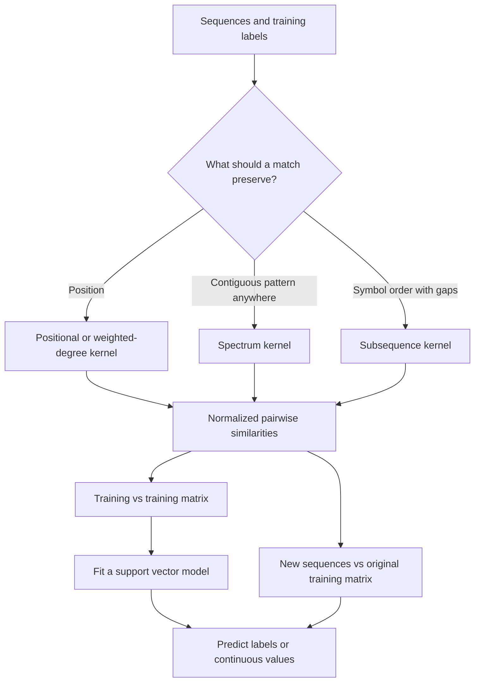

# String Kernels for LIBSVM

**Support vector learning directly from sequences.** This project computes
normalized string-kernel similarities for classification and regression, with a
C++17 kernel library and unmodified LIBSVM training and prediction tools.

A string kernel compares sequences through shared patterns rather than requiring
a manually constructed feature table. Different kernels encode different
assumptions: whether a pattern's position matters, whether it must be contiguous,
and whether gaps should reduce its contribution. Those assumptions should follow
the scientific question and the way the sequences were collected.

## How it works

For a feature map $\phi$, a kernel is the inner product
$k(x,z)=\langle\phi(x),\phi(z)\rangle$. Here, the features describe matching
symbols, substrings, or subsequences. The library computes the similarity without
requiring users to enumerate the full feature space.



Training produces a square Gram matrix. Prediction uses a rectangular matrix:
each row describes a new sequence, and each column corresponds to an original
training sequence **in the same order used during fitting**. The string kernel
defines similarity; LIBSVM learns the decision function from that matrix [4].

## Which kernel fits the question?

| Method | Features and assumptions | Reference |
| --- | --- | --- |
| **Positional similarity** | Matching symbols at corresponding positions. Requires aligned sequences of equal length. The historical name `DSK` denotes this simple indicator-feature baseline, not edit distance. | Definition in [kernel reference](docs/KERNELS.md#positional-similarity-converter-type-0). |
| **Weighted degree** | Exact substrings at corresponding positions, combining orders up to a chosen degree. Suitable when alignment carries meaning. Default: degree `5`. | Aligned weighted-degree formulation in Sonnenburg et al. [1], §3.1.1, Eq. (14), p. 1542. |
| **Spectrum** | Counts of exact, contiguous length-$k$ substrings, independent of position. A motif can move while retaining similarity. | Leslie, Eskin, and Noble [2]. |
| **Subsequence** | Ordered length-$k$ patterns, including gapped occurrences. A decay parameter discounts gaps. More expensive than contiguous matching. | Lodhi et al. [3]. |

For example, `ACG` and `GAC` share the contiguous pattern `AC` at different
positions; the spectrum kernel captures that match. `ACG` and `AG` share the
ordered pattern `AG` with a gap; the subsequence kernel captures it. Positional
methods instead ask whether patterns occur at the same coordinates.

Weighted-degree, spectrum, and subsequence kernels use their feature-map
definitions and cosine normalization:

$$K(x,z)=\frac{k(x,z)}{\sqrt{k(x,x)\,k(z,z)}}.$$

A zero self-kernel yields zero. Positional similarity is already normalized by
sequence length. The [mathematical reference](docs/KERNELS.md) specifies weights,
normalization, edge cases, and analytical computational costs. It also identifies
this project's unequal-length weighted-degree extension and the subsequence
implementation's normalization-equivalent gap-only weighting; neither is a claim
that the original papers used precisely this implementation.

## What the examples establish

The [visual walkthrough](docs/ANALYSIS.md) compares aligned, moved, and gapped
motifs using similarity matrices and actual LIBSVM predictions.


These deliberately constructed examples check whether the implementations reflect
their intended feature definitions. They do not establish predictive accuracy on
biological sequences or text. A research application still needs an appropriate
split strategy, training-only parameter selection, and independent evaluation.
Related or duplicate sequences across splits can make performance misleading.

Inputs are case-sensitive byte strings. The command-line reader expects a
sequence token and numeric label per record. It does not parse FASTA, infer an
alphabet, align sequences, or normalize Unicode. Dense Gram matrices grow
quadratically with the number of training examples; the gapped subsequence
kernel also has substantial per-pair computation and memory costs.

## Using the project

| Goal | Guide |
| --- | --- |
| Build the existing tools and run classification or regression | [Command-line quickstart](docs/QUICKSTART.md). |
| Understand formulas, parameters, and matrix layout | [Kernel reference](docs/KERNELS.md). |
| Install a compiled package and use scikit-learn | [Python guide](docs/PYTHON.md) and [release downloads](https://github.com/cttsai1985/string-kernels-libsvm/releases/tag/v1.0.0). |
| Develop, test, or install the C++ library | [Development](docs/DEVELOPMENT.md) and [compatibility](docs/COMPATIBILITY.md). |

Build-system commands and generated file paths belong in the quickstart rather
than in this conceptual overview. The installed C++ command is `string-kernels`. The Python distribution is
`string-kernels-libsvm`, imported as `stringkernels`.

### scikit-learn interoperability

The integration boundary is a **precomputed kernel matrix**. Scikit-learn's
[`SVC`](https://scikit-learn.org/stable/modules/generated/sklearn.svm.SVC.html)
and [`SVR`](https://scikit-learn.org/stable/modules/generated/sklearn.svm.SVR.html)
accept these matrices through `kernel="precomputed"`. Their LIBSVM-based solvers
can therefore use the similarities produced here without a solver modification.
[`LinearSVC`](https://scikit-learn.org/stable/modules/generated/sklearn.svm.LinearSVC.html)
uses LIBLINEAR and does not accept a precomputed-kernel option.

The existing CLI writes LIBSVM text records containing a label and a `0:serial`
field before the kernel entries. Scikit-learn instead expects only a dense
numeric array of similarities, with labels supplied separately: training shape
`(n_train, n_train)` and prediction shape `(n_new, n_train)`. Do not pass the
label or serial column as kernel values. Cross-validation must preserve each
fold's training-reference columns.

The compiled Python package exposes `pairwise` for NumPy matrices and a
`StringKernel` transformer for scikit-learn Pipelines. The transformer keeps
training references within each cross-validation fold:

```python
from sklearn.pipeline import make_pipeline
from sklearn.svm import SVC
from stringkernels.sklearn import StringKernel

model = make_pipeline(StringKernel(kernel="spectrum", degree=2), SVC(kernel="precomputed"))
model.fit(["ACG", "ACT", "GGA", "GGT"], [1, 1, -1, -1])
model.predict(["ACC", "GGC"])  # array([1, -1])
```

Use `SVR(kernel="precomputed")` for regression. See the [Python guide](docs/PYTHON.md)
for compiled-wheel installation, the matrix API, tuning, and resource limits.
The release is distributed through GitHub Releases; PyPI publication is separate.

## References and attribution

Cite the method actually used and the solver when reporting results. These
references describe the methods; they do not imply endorsement of this project
or transfer a software license. Machine-readable entries are in
[REFERENCES.bib](REFERENCES.bib).

1. S. Sonnenburg, G. Rätsch, C. Schäfer, and B. Schölkopf. **Large Scale Multiple
   Kernel Learning.** *Journal of Machine Learning Research*, 7(57):1531–1565,
   2006. Weighted-degree definition: §3.1.1, Eq. (14), p. 1542.
   [Publisher](https://jmlr.org/papers/v7/sonnenburg06a.html).
2. C. Leslie, E. Eskin, and W. S. Noble. **The Spectrum Kernel: A String Kernel
   for SVM Protein Classification.** *Pacific Symposium on Biocomputing*,
   7:564–575, 2002.
   [Author-hosted paper](https://noble.gs.washington.edu/papers/spectrum.html).
3. H. Lodhi, C. Saunders, J. Shawe-Taylor, N. Cristianini, and C. Watkins.
   **Text Classification using String Kernels.** *Journal of Machine Learning
   Research*, 2:419–444, 2002.
   [Publisher](https://jmlr.org/papers/v2/lodhi02a.html).
4. C.-C. Chang and C.-J. Lin. **LIBSVM: A Library for Support Vector Machines.**
   *ACM Transactions on Intelligent Systems and Technology*, 2(3), Article 27,
   2011. [DOI](https://doi.org/10.1145/1961189.1961199).
5. F. Pedregosa et al. **Scikit-learn: Machine Learning in Python.** *Journal of
   Machine Learning Research*, 12:2825–2830, 2011. Cite when using scikit-learn.
   [Publisher](https://jmlr.org/papers/v12/pedregosa11a.html).

For reproducibility, also record the project commit, kernel parameters,
preprocessing, data partition, and solver version. No archival software DOI is
assigned by this README.

## License

Licensed under [BSD-3-Clause](LICENSE).
