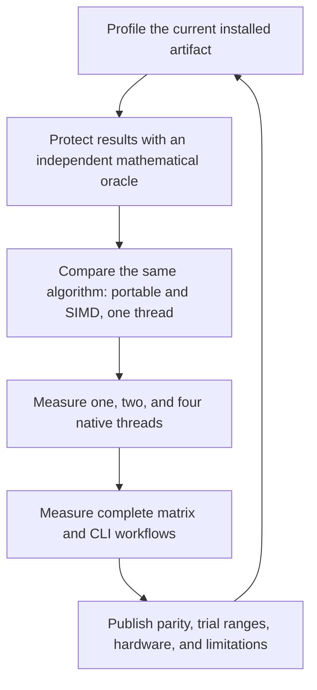

# Optimizing kernel speed

Standard practice is to measure the bottleneck, preserve the mathematical result,
and test hardware acceleration against a portable implementation. This project
follows that approach: distributable wheels select supported CPU instructions at
runtime, and callers explicitly choose how many native threads to use.

## What changed at each level

Version `1.0.1` reduced repeated work: a matching-run scan for weighted degree,
per-sequence spectrum counts, and symmetry reuse in Python training matrices.
Version `1.1.0` adds hardware execution: AVX2/POPCNT on supported x86 CPUs,
NEON on supported ARM64 builds, and native threads across matrix rows. These
changes preserve the kernel definitions in [KERNELS.md](KERNELS.md).

A Release build enables compiler optimizations; that alone does not demonstrate
SIMD execution. The hardware comparison uses the same mask/count algorithm in
portable and explicit SIMD modes, then measures multicore execution separately.



## Comparing many bytes with one instruction

Positional and weighted-degree kernels first need same-position byte equality.
The SIMD backend compares a complete block, producing a mask with one bit per
matching byte. For illustration, this short example is shown in increasing
position order:

```text
sequence A:  A C G T A C G A
sequence B:  A C C T T C G A
equal:       1 1 0 1 0 1 1 1
```

There are six matching bytes, three starts of matching length-two substrings,
and one start of a matching length-three substring. Combining shifted equality
masks finds those starts; population counts give their frequencies. Applying the
existing degree weights produces the same weighted-degree dot product. A second
block carries matches across a block boundary.

The x86 implementation compares 32 bytes using AVX2 and counts set bits using
POPCNT. The ARM64 implementation combines two 16-byte NEON comparisons into the
same mask representation. Arm defines these comparison, load, and reduction
intrinsics in its [Neon reference](https://arm-software.github.io/acle/neon_intrinsics/advsimd.html).

Only complete blocks use vector loads. A final span shorter than 32 bytes uses
scalar comparisons, avoiding reads beyond either string. Weighted-degree orders
above 32 retain the `1.0.1` matching-run scan. Spectrum and SSK have no explicit
SIMD pair implementation in this release. A preferred backend reported as
`avx2` or `neon` therefore does not prove that a particular short input or kernel
executed vector instructions.

## Keeping wheels portable

The AVX2 source file alone receives `-mavx2 -mpopcnt` on GCC/Clang or
`/arch:AVX2 /fp:strict` on MSVC. The dispatcher and portable implementation retain the
platform baseline. No package-wide `-march=native` is used. GCC documents why
[detection code must be compiled without the optional ISA flags](https://gcc.gnu.org/onlinedocs/gcc/x86-Built-in-Functions.html);
its [target attributes](https://gcc.gnu.org/onlinedocs/gcc/x86-Function-Attributes.html)
provide a function-level alternative to the separate-source approach used here.

Runtime checks require AVX2 and POPCNT support. The MSVC path also checks BMI2
and OS support for saving the required AVX register state before dispatch. Its
strict floating-point flag prevents FMA contraction. Microsoft documents
[CPU feature queries](https://learn.microsoft.com/en-us/cpp/intrinsics/cpuid-cpuidex),
[additional instructions permitted by `/arch`](https://learn.microsoft.com/en-us/cpp/build/reference/arch-x64),
and [floating-point contraction rules](https://learn.microsoft.com/en-us/cpp/build/reference/fp-specify-floating-point-behavior).
Unsupported targets use the portable implementation; supported ARM64 builds use
NEON. Installed-wheel tests cover the supported compilers and operating systems.

`backend='auto'` selects safe dispatch; `backend='scalar'` disables the explicit
SIMD backend while retaining the same mask algorithm. The compiler may still
optimize portable C++. To test a build containing no optional SIMD backends,
after the normal [bootstrap](DEVELOPMENT.md):

```sh
cmake --preset dev -DSTRINGKERNEL_ENABLE_SIMD=OFF
cmake --build --preset dev
ctest --preset dev
```

## Using more CPU cores

```python
matrix = pairwise(sequences, degree=5, backend='auto', n_jobs=4)
transformer = StringKernel(degree=5, backend='auto', n_jobs=4)
```

`n_jobs` is a positive maximum native worker count; its default is `1`, and `-1` is
unsupported. Workers share immutable prepared sequences and claim independent
rows. Symmetric Python matrices assign each pair and its mirror to one worker.
The GIL is released during native calculation. Exceptions are captured, active
workers finish, and every thread joins before an error returns to Python.
[CMake's threading target](https://cmake.org/cmake/help/latest/module/FindThreads.html)
provides platform-specific linkage without introducing an OpenMP runtime.

Choose one parallel level: use `StringKernel(n_jobs=1)` inside
`GridSearchCV(n_jobs=4)`, or parallelize the kernel while the outer search runs
one job. These `std::thread` workers are not automatically limited by joblib or
threadpoolctl. Scikit-learn explains
[oversubscription](https://scikit-learn.org/stable/computing/parallelism.html), and
joblib documents [which native runtimes it limits](https://joblib.readthedocs.io/en/stable/user_guide/parallel.html).
SSK's pair workspace grows with the number of active workers; more threads can
increase memory pressure instead of improving elapsed time.

The CLI accepts `--threads N --backend auto|scalar`. Workers format bounded
blocks of at most 64 rows; the caller writes them in their original order. This retains
streaming output with bounded additional text buffers. Input parsing, startup,
formatting, and file output remain part of CLI elapsed time. Kernel acceleration
does not imply the same acceleration in LIBSVM training or a complete pipeline.

## Measuring the improvement

[The hardware harness](../benchmarks/benchmark_hardware.py) compares `1.0.1`, the
current portable backend, automatic SIMD at one thread, and automatic dispatch
at two/four threads. It checks every matrix cell before accepting results.
[Raw hardware records](../benchmarks/results/hardware-linux.json) retain trials,
CPU/wall time, backend readback, affinity, input hashes, and artifact provenance;
[the earlier report](BENCHMARKS.md) retains the v1.0.1 algorithm-only comparison.

Profile first; test complete matrices against independent feature maps; compare
matching compiler builds; then vary only backend or thread count. Include tiny
inputs, realistic sequence lengths, rectangular prediction matrices, and a
complete CLI conversion. Record trial ranges and slower cases. Thread startup,
serial preparation, memory traffic, and output can limit scaling. Treat an
unmeasured speedup as a hypothesis, and keep hardware timing separate from
predictive accuracy.


## Measured hardware results

**MEASURED on 2026-11-17:** AMD Ryzen Threadripper PRO 5965WX, Linux/WSL2,
CPython 3.12.13, NumPy 2.2.6. Both source versions use GCC 13.3.0, CMake 4.4.4
Release (`-O3 -DNDEBUG`, C++17), and pybind11 3.1.0 with LTO. Only the AVX2
translation unit adds `-mavx2 -mpopcnt`. Baseline is
[v1.0.1 commit 6e3990d](https://github.com/cttsai1985/string-kernels-libsvm/commit/6e3990d181e764595adcef69445508d639dee413).
The candidate is the issue #24 implementation released as `1.1.0`.

The dispatcher reported `avx2`. The
[actual benchmark extension's disassembly](../benchmarks/results/hardware-avx2.txt)
contains `vpcmpeqb`, `vpmovmskb`, and `popcnt`; its SHA matches the raw benchmark
records. Disassembly establishes instruction presence, not execution counts.
The runtime dispatch and sufficiently long tested inputs select that evaluator.
ARM NEON receives installed-wheel correctness checks, but no ARM speed claim is
made from this x86 measurement.

All times below are **MEASURED milliseconds: median [minimum–maximum]** from five
fresh-process trials per backend. Dimensions are rows×columns; byte length;
degree. `Portable 1` and `SIMD 1` use the same mask/count algorithm, so that
comparison isolates the explicit byte-comparison/popcount backend. The baseline
comparison also includes evaluation and preparation changes. Degrees above 32,
spectrum, and SSK do not gain explicit SIMD pair evaluation.

| Workload | Dimensions; length; degree | v1.0.1, 1 thread | Portable 1 | SIMD/auto 1 | Auto 2 | Auto 4 |
| --- | --- | --- | --- | --- | --- | --- |
| Tiny WD prediction | 16×12; 12; 3 | 0.034 [0.032–0.070] | 0.048 [0.038–0.143] | 0.051 [0.040–0.080] | 0.150 [0.115–0.188] | 0.264 [0.245–0.467] |
| Protein WD training | 192×192; 64; 5 | 2.779 [2.480–3.150] | 2.627 [2.405–3.419] | 1.886 [1.273–4.457] | 2.685 [1.761–4.530] | 2.324 [1.604–5.236] |
| Similar WD training | 48×48; 192; 64 | 0.498 [0.412–0.807] | 0.574 [0.477–1.333] | 0.575 [0.496–0.775] | 0.767 [0.550–1.434] | 0.843 [0.576–1.295] |
| Protein WD prediction | 128×256; 64; 5 | 4.492 [3.899–4.866] | 4.596 [4.343–4.752] | 2.577 [2.444–2.862] | 2.504 [2.194–2.562] | 2.467 [2.189–3.509] |
| Short degree-one WD | 512×512; 32; 1 | 15.359 [14.297–16.406] | 7.370 [6.256–8.405] | 3.160 [2.763–3.491] | 3.201 [2.745–3.803] | 2.942 [2.496–3.221] |
| Exact-3 spectrum | 128×128; 128; 3 | 14.539 [12.901–15.829] | 15.617 [11.872–18.769] | 14.964 [12.856–16.558] | 15.214 [9.725–17.483] | 11.935 [11.228–20.209] |
| Large protein WD training | 512×512; 256; 5 | 45.649 [42.415–48.455] | 37.757 [36.981–42.120] | 12.047 [11.928–20.333] | 11.621 [8.746–12.303] | 9.283 [8.980–10.872] |
| Large protein WD prediction | 384×768; 256; 5 | 103.660 [93.599–118.355] | 89.658 [87.484–90.412] | 26.740 [26.077–32.460] | 25.244 [16.531–27.744] | 21.613 [17.509–29.183] |
| Large similar WD, degree 64 | 256×256; 256; 64 | 13.266 [11.587–14.130] | 15.809 [12.031–18.349] | 16.186 [13.348–23.557] | 12.501 [9.943–16.226] | 11.201 [8.817–16.403] |
| Long degree-one WD | 512×512; 256; 1 | 121.516 [93.672–140.824] | 43.647 [39.459–44.932] | 5.792 [3.679–6.138] | 6.321 [4.336–7.226] | 6.471 [3.550–8.036] |
| Positional training | 512×512; 256; 1 | 14.934 [13.983–15.093] | 41.342 [39.418–42.018] | 4.716 [4.303–5.666] | 4.626 [3.460–4.732] | 5.404 [3.730–8.800] |
| SSK training | 16×16; 24; 3 | 1.951 [1.801–2.021] | 2.031 [1.711–2.191] | 2.155 [1.977–3.040] | 2.047 [1.520–2.238] | 1.569 [1.322–2.028] |

For large protein WD training, the portable-to-SIMD median changes from 37.757
to 12.047 ms (**MEASURED 3.13×**). For long degree-one WD it changes from 43.647
to 5.792 ms (**MEASURED 7.54×**). Those are workload-specific hardware gains.
The small case regresses relative to `1.0.1`, and threading sometimes slows
execution; one native thread remains the default.

Workers were restricted to CPUs `0,2,4,6`, which Linux topology reports as four
distinct physical cores. This WSL host was not isolated. No project builds or
tests ran alongside the final benchmark, but CPU pressure and hypervisor/host
scheduling were not controlled. For example, the large protein four-thread
run has a MEASURED median process-CPU/wall ratio of about 1.27, far below four.
These timings therefore do not establish ideal four-core scaling or its exact
limiter. CPU/wall ratios, all repetitions, warmups, hashes, and affinity remain
in the raw records. No cgroup CPU quota or throttling was observed during a
separate diagnostic readback.

### Complete converter costs

These **MEASURED milliseconds** include process launch, input parsing,
preparation, row calculation/formatting and temporary-file output. Parsing the
output back for full parity is outside timing. They are a different boundary
from the NumPy matrix operation and do not measure SVM training.

| Workload | v1.0.1 CLI | Portable 1 | SIMD/auto 1 | Auto 2 | Auto 4 |
| --- | --- | --- | --- | --- | --- |
| Tiny WD prediction | 5.109 [4.058–1076.953] | 5.544 [4.870–6.166] | 5.897 [5.209–6.351] | 6.530 [5.190–9.080] | 6.242 [4.897–7.882] |
| Protein WD training | 54.113 [44.243–116.436] | 61.426 [34.630–92.708] | 52.840 [37.430–71.396] | 33.500 [28.831–47.126] | 39.787 [24.524–42.637] |
| Similar WD training | 7.325 [6.176–10.997] | 8.231 [6.618–11.397] | 8.160 [5.660–9.360] | 9.731 [6.750–9.820] | 7.528 [5.838–15.576] |
| Protein WD prediction | 32.005 [25.576–36.222] | 30.658 [25.661–37.942] | 29.737 [28.343–35.790] | 28.766 [21.893–34.538] | 28.273 [18.015–34.516] |
| Short degree-one WD | 194.720 [163.507–244.604] | 154.398 [113.783–177.557] | 148.013 [142.085–260.971] | 139.802 [122.803–157.567] | 119.018 [108.562–151.666] |
| Exact-3 spectrum | 45.207 [38.877–58.007] | 43.331 [36.359–55.126] | 47.589 [35.867–54.364] | 41.270 [32.750–52.999] | 39.229 [23.274–44.197] |
| Large protein WD training | 216.402 [202.538–255.725] | 219.651 [202.358–284.911] | 157.637 [149.577–162.279] | 146.508 [113.481–154.759] | 121.566 [107.587–127.705] |
| Large protein WD prediction | 247.745 [225.984–261.030] | 237.383 [208.968–242.768] | 163.059 [146.130–183.997] | 117.913 [74.808–138.944] | 146.041 [117.732–225.509] |
| Large similar WD, degree 64 | 56.845 [43.622–62.304] | 63.471 [55.710–67.131] | 55.031 [53.001–74.221] | 55.872 [50.976–82.648] | 51.401 [43.483–71.811] |
| Long degree-one WD | 456.986 [351.820–529.992] | 324.448 [238.313–406.907] | 212.149 [107.697–296.572] | 136.072 [121.303–217.685] | 144.848 [99.478–171.612] |
| Positional training | 182.531 [167.151–210.986] | 237.723 [208.279–253.447] | 153.939 [126.130–168.250] | 160.097 [113.502–227.953] | 149.413 [92.185–179.615] |
| SSK training | 9.671 [9.394–11.102] | 9.090 [7.864–9.647] | 8.790 [8.328–10.936] | 8.967 [6.869–9.625] | 8.942 [7.736–10.548] |

### Experiments that informed the implementation

The CLI compared blocks of 4, 32, and 64 rows at four workers, with three
interleaved trials and complete matrix parity. For large protein training,
MEASURED median times were 138.726, 79.191, and 65.746 ms respectively. The
32/64-row ranges did not overlap in that experiment; other workloads had
mixed results or overlapping ranges. The implementation chooses a fixed maximum
of 64 buffered rows for multiple workers and one row for serial execution.
This is a bounded memory/launch-cost choice, not a universal optimum. Raw block
results are in `provenance.cli_block_experiment` of the hardware JSON.

A separate three-trial experiment compared current mirrored writes with a
second serial or parallel mirror-copy phase. All 36 matrices matched.
Parallel copy improved one protein case but had a worse degree-one median;
high-similarity ranges overlapped substantially. The production implementation
keeps its simpler single-pass ownership. The experiment does **not** establish
false sharing as the limiter; no coherence-event counters were collected.
Its full results are in `experiments.mirror_layout` of the hardware JSON.

### Reproduce and interpret

Use the [wheel-preparation steps](BENCHMARKS.md#reproduce-the-measurement),
substituting baseline commit `6e3990d181e764595adcef69445508d639dee413` for the
older baseline. Build both versions with the same compiler, interpreter and
Release settings, and extract their wheels into separate package directories.
Then run:

```sh
python benchmarks/benchmark_hardware.py --baseline-root build/benchmark-reproduction/baseline-package --candidate-root build/benchmark-reproduction/candidate-package --trials 5 --seconds 0.2 --affinity-width 4 --output build/hardware-results.json
```

Optional `--baseline-cli` and `--candidate-cli` add the standalone converter
boundary. `--provenance build-description.json` records compiler flags and source
identifiers. The harness runs backends serially in shuffled order, recreates the
same seeded inputs, warms up once, and measures adaptive blocks of at least
0.2 seconds. It includes per-call preparation, allocation, normalization and
worker launch/join; imports and warmup are excluded. Every matrix cell must match
the baseline (`rtol=1e-11`, `atol=1e-12`), with independent feature-map and
vector-boundary tests protecting the mathematics separately.

[CPU CI](../.github/workflows/hardware.yml) checks a compiled portable-only
build, installed vector-sized inputs, full matrix parity and a broad SIMD
performance floor on capable runners. The timing gate is not a latency promise.
The hardware suite uses synthetic inputs, does not collect peak RSS, and makes
no claim about biological predictive quality, solver speed, GPUs, or another
machine's absolute timings. Dense Python output remains analytically `8*N*M`
bytes, plus prepared data and per-worker kernel workspace.
